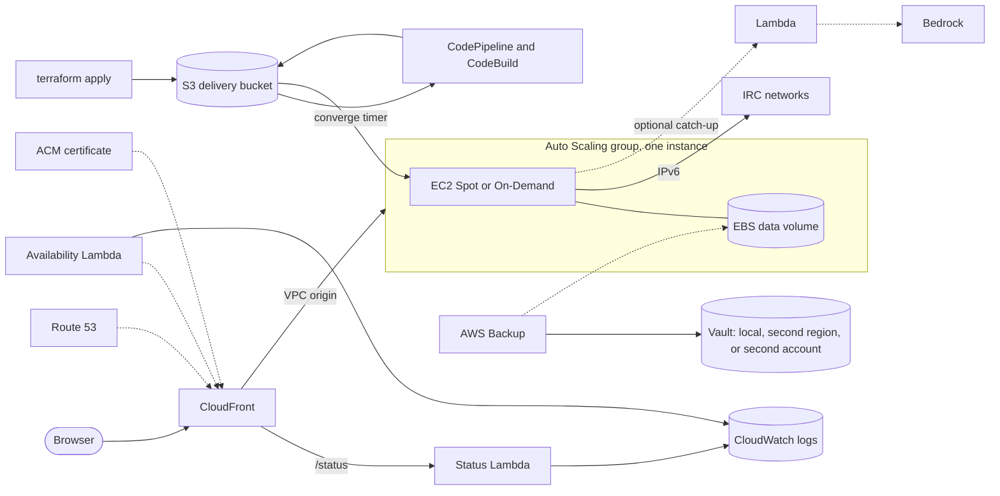

# The Lounge on AWS

A Terraform module that runs [The Lounge](https://thelounge.chat/), a self-hosted web IRC client that stays connected for you, on AWS for a few dollars a month. It is an independent project, unofficial and not affiliated with or endorsed by The Lounge project.

The module serves one shape: a single instance, Spot or On-Demand, behind CloudFront, with the data on an EBS volume. There is no public IPv4 address by default. IRC rides outbound IPv6, the web client reaches the instance through a CloudFront VPC origin, and the one break-glass door is EC2 Instance Connect Endpoint SSH. The instance backs up locally, to a second region, or to a second AWS account. Optional parts are `/summarize` and `/ask` channel catch-up on Amazon Bedrock and an operational status page, served by [terraform-aws-status-page](https://github.com/kjiwa/terraform-aws-status-page).

Required inputs are `domain_name`, `zone_id`, and `alert_email`. Everything else has a default; the [module reference](#module-reference) lists them.

## Architecture



`terraform apply` writes the desired release to the delivery bucket. An EventBridge rule starts the pipeline, which builds The Lounge and its plugins for each architecture, and the instance's converge timer installs the result within about five minutes. A change to `thelounge_version`, `node_version`, or `thelounge_plugins` is the deploy; [`scripts/deploy.sh`](#operating) waits for it to land.

## Cost

Estimated monthly cost in USD at list prices in us-east-1, before tax. These are estimates, not measurements, and move with region, instance type, Spot prices, and usage.

| Item | Per month |
|---|---:|
| EC2 Spot, nano-class | 1.00 (about 3.07 On-Demand, `spot_enabled = false`) |
| EBS gp3, 8 GB root and 8 GB data | 1.28 |
| Route 53 hosted zone | 0.50 |
| Backup `local` | 0.10 |
| Backup `cross_region` | 0.20 |
| Backup `cross_account` | 2.25 (two KMS keys) |
| Disk usage metric and alarm (the CloudWatch free tier likely covers it) | 0.41 |
| CloudFront, ACM, Instance Connect Endpoint, VPC origin, S3 gateway endpoint, Lambdas, EventBridge, SNS, CodeBuild and CodePipeline free tiers | 0.05 |

A Spot deployment with `cross_account` backup runs about 5.50 USD a month, plus about 0.35 USD for keel's `audit` and `finops` modules. `enable_public_ipv4` adds about 3.65 USD, and `dnssec` on the hosted zone about 1 USD. Catch-up on one busy channel costs about 0.02 USD of Bedrock input tokens a month.

Left out on purpose, because they would cost more than they would tell you on a single-instance deployment: WAF, GuardDuty, Config, Security Hub, a NAT gateway, a load balancer, multi-AZ, the CloudWatch agent, SSM, and AWS Backup restore testing.

## Backups

The irreplaceable data is the EBS data volume: users, IRC network configs, SQLite message logs, and uploads. AWS Backup takes a daily recovery point (`backup.schedule`, 03:00 UTC by default). `backup.mode` picks where it also goes.

| Mode | Copy | Protects against |
|---|---|---|
| `local` | None. Recovery points stay in a vault in the same account and region. | Corruption, a bad upgrade, or accidental deletion. |
| `cross_region` | A second vault and key in `backup_region`. | Loss of the primary region. |
| `cross_account` | A vault owned by a separate AWS account (`backup.account_id`). | Loss or compromise of the workload account, including deletion of its backups. The destination vault can be locked so that nobody can delete recovery points. |
| `disabled` | No backups. | Nothing. |

Only `cross_account` produces a copy the workload account cannot delete. With `backup_region` set to a region other than the module's, it also covers a region outage. `scripts/backup.sh` takes an app-consistent snapshot before a risky change, or a recovery point right now instead of at 03:00.

Procedures: [cross-account backup](docs/cross-account-backup.md), [restore](docs/restore.md), [AZ move](docs/az-move.md).

## Managing users

There is no admin UI. Declare users in `thelounge_users`, or create them on the instance.

Pre-seed a user with a bcrypt hash, never the plaintext password:

```hcl
thelounge_users = {
  alice = "<bcrypt hash from `thelounge hash`>"
}
```

A seeded user appears after the instance's next converge run, up to about five minutes after apply. The converge script creates a user's file only when it is absent, so leaving `thelounge_users` set across applies is safe, and changing a hash does nothing for a user that already exists. Removing an entry does not delete the user's file.

To create, reset, or remove a user interactively, connect over EC2 Instance Connect Endpoint SSH:

```sh
aws ec2-instance-connect ssh --instance-id <id> --connection-type eice --os-user ec2-user
sudo -u thelounge THELOUNGE_HOME=/srv/thelounge/data \
  /opt/thelounge/current/node/bin/node \
  /opt/thelounge/current/app/node_modules/.bin/thelounge add <name>
```

Use `reset` or `remove` in place of `add` for the other two.

Add IRC networks in the client. With IPv6-only egress:

- Only servers with an AAAA record are reachable. A round-robin host that resolves to an IPv4-only node hangs.
- Some networks, Libera Chat among them, require SASL from cloud addresses. Register and verify the account from a non-cloud connection first, then configure SASL with the account name, not the email.
- Some servers present self-signed or expired certificates; uncheck "Only allow trusted certificates" for those networks.
- The Lounge keeps IRC connections open server-side, so closing the browser does not disconnect you.

## Status page

`https://<hostname>.<domain_name>/status` is the status-page core configured for The Lounge: reliability, incidents, Spot interruptions, a change log, host and storage panels, a Backups panel (job history and the off-site vault's lock state; off when `backup.mode` is `disabled`), an optional Bedrock panel, and facts from the instance. It is read-only and gated on being signed in to The Lounge: sign in at `/` first, then load `/status`. The gated routes call the instance, so they work only while chat is up.

It is off unless `status.enabled` is set. `status.public_reliability` serves redacted uptime and incident history at `/status/public` without sign-in, and that keeps working while chat is down. `status.bedrock` adds the catch-up model's token usage and needs `catchup.enabled`. The status Lambda reserves no concurrency because a new account's quota is 10.

## Sleeping the site

`active = false` drops the Auto Scaling group to zero instances and suspends the availability canary and alarm notifications, and keeps everything stateful: the data volume, DNS, certificate, and last build. Setting it back to `true` and applying wakes the site in about five minutes, because the new instance converges to the last release by itself. Sleeping costs about 1.90 USD a month. `terraform destroy` stops by design while the data volume is `prevent_destroy`.

## Requirements

- Terraform 1.15 or later and the AWS provider 6.0 or later. The module needs an `aws.us_east_1` provider alias for the CloudFront certificate.
- A public Route 53 hosted zone for `domain_name`, passed as `zone_id`. [terraform-aws-keel](https://github.com/kjiwa/terraform-aws-keel)'s `dns` module creates one.
- For the operator scripts under `scripts/`: the AWS CLI, `terraform`, `jq`, and `curl`.
- For catch-up (`catchup.enabled`): model access enabled in the Bedrock console.

## Quickstart

[examples/minimal](examples/minimal) composes the module with keel's DNS, cost budget, and audit modules.

1. Reference the module from your own root, pinned to a release, and export it:

   ```hcl
   module "thelounge" {
     source = "git::https://github.com/kjiwa/terraform-aws-thelounge.git?ref=v1.0.0"
     providers = {
       aws           = aws
       aws.us_east_1 = aws.us_east_1
     }

     domain_name = "example.org"
     zone_id     = module.dns.zone_ids["example.org"]
     alert_email = "you@example.org"
   }

   output "thelounge" {
     value = module.thelounge
   }
   ```

2. Apply. The first apply creates the hosted zone and then waits on certificate validation. Read the name servers with `terraform output -json name_servers` and set them at your registrar while it waits; re-running an apply that timed out is safe. The zone becomes authoritative for the whole apex, so port every existing record there before you change the registrar.

   ```sh
   cd examples/minimal
   terraform init
   terraform apply -var domain_name=example.org -var alert_email=you@example.org
   ```

3. Confirm the SNS subscription emails (alerts, audit, and cost).

4. Wait for the release to land. `--root` is the directory that instantiates the module.

   ```sh
   scripts/deploy.sh --root examples/minimal
   ```

5. Create your first user and sign in; see [Managing users](#managing-users).

## Security and limits

- The only inbound path is CloudFront. With the default zero-IPv4 posture the instance has no public address, and the origin security group admits the CloudFront origin-facing prefix list only.
- `thelounge_users` values authenticate access to the deployment. Treat them as sensitive; they live in Terraform state and in the delivery bucket.
- One deployment per AWS account: the delivery bucket and CodeBuild projects are named per account, and `env` namespaces only per-environment resources.
- `prevent_destroy` on the data volume makes `terraform destroy` stop by design.
- The Lounge keeps message logs and has no size cap. `disk_alarm_used_percent` alerts before a full disk becomes an outage.

## Operating

The operator scripts take the Terraform root that instantiates the module, as `--root DIR` before the subcommand or `THELOUNGE_ROOT`. They read region, account, and resource names from `terraform output -json thelounge`, so the root must export the module as one object:

```hcl
output "thelounge" {
  value = module.thelounge
}
```

`AWS_PROFILE` selects the account. Terraform runs with `-chdir=DIR` and inherits `TF_DATA_DIR` and `TF_CLI_ARGS_*`.

| Script | Purpose |
|---|---|
| `scripts/deploy.sh [--root DIR]` | Wait for the applied release: the pipeline run, the instance's acknowledgement, then a 200 from the site. Exits non-zero naming the stage that timed out. |
| `scripts/backup.sh` | On-demand snapshot or AWS Backup recovery point, and backup status. |
| `scripts/restore.sh` | Every restore path, and the pre-lock restore drill. |
| `scripts/azmove.sh` | Move or re-key the data volume. |
| `scripts/docs.sh` | Regenerate the module reference below. |

Procedures: [cross-account backup](docs/cross-account-backup.md), [restore](docs/restore.md), [AZ move](docs/az-move.md).

## Contributing and security

See [CONTRIBUTING.md](CONTRIBUTING.md) and [SECURITY.md](SECURITY.md). Licensed under the Apache License 2.0.

## Module reference

<!-- BEGIN_TF_DOCS -->
## Requirements

| Name | Version |
| ---- | ------- |
| terraform | >= 1.15 |
| aws | >= 6.0 |

## Resources

| Name | Type |
| ---- | ---- |
| [aws_region.default](https://registry.terraform.io/providers/hashicorp/aws/latest/docs/data-sources/region) | data source |

## Inputs

| Name | Description | Type | Default | Required |
| ---- | ----------- | ---- | ------- | :------: |
| alert\_email | Email address for operational alerts (site up/down). Confirm the SNS subscription after the first apply. | `string` | n/a | yes |
| domain\_name | Apex domain this environment serves (e.g. example.org), combined with hostname for the CloudFront alias and ACM certificate. Its public Route53 hosted zone must already exist (zone\_id). | `string` | n/a | yes |
| zone\_id | ID of the existing public Route53 hosted zone for domain\_name, used for ACM validation and alias records. | `string` | n/a | yes |
| active | If false, the environment sleeps: the ASG holds zero instances, and the availability canary and alarm notifications are suspended, while all state (data volume, DNS, ACM certificate, last build) is retained. Waking (flip true, apply) self-deploys the last release via the converge timer. Deploys still require an awake environment. | `bool` | `true` | no |
| ami\_ids | Per-architecture AMI IDs, keyed "arm64" and "x86\_64". Null (default) resolves both from AL2023 SSM public parameters at apply time. Pin to freeze the fleet at a specific image; changes roll out via the ASG's instance refresh. | `map(string)` | `null` | no |
| az | Availability zone for the instance and its EBS data volume. Null (default) uses the region's first available AZ. Pin before other changes on an existing deployment -- moving AZ later replaces both the subnet and the volume (see docs/az-move.md). | `string` | `null` | no |
| backup | Off-site backup destination for the EBS data volume, via one AWS Backup plan. | ```object({ mode = optional(string, "local") schedule = optional(string, "cron(0 3 * * ? *)") retention_days = optional(number, 7) remote_retention_days = optional(number, 0) account_id = optional(string, "") dest_vault_name = optional(string, "thelounge-backup") })``` | `{}` | no |
| backup\_region | Destination region for off-site backup copies. The replica vault is created there only under cross\_region. Under cross\_account, must match the backup account's own region -- a mismatch fails at copy-job runtime, not plan time. | `string` | `"us-east-2"` | no |
| catchup | /summarize and /ask channel catch-up (npm: thelounge-plugin-catchup); disabled adds no plugin, Lambda or IAM. The instance invokes a Bedrock-calling Lambda over IPv6, so no IPv4 is needed; version is the plugin npm version, provider is lambda only, model\_id is a Bedrock model or inference profile ID, region empty uses the module's region, time\_zone is an IANA name (e.g. Europe/Berlin) for /summarize day boundaries and printed times, empty uses the instance zone, max\_window\_hours caps how far back /summarize and /ask look (hours, > 0). | ```object({ enabled = optional(bool, false) version = optional(string, "0.6.1") provider = optional(string, "lambda") model_id = optional(string, "us.amazon.nova-2-lite-v1:0") region = optional(string, "") time_zone = optional(string, "") max_window_hours = optional(number, 24) })``` | `{}` | no |
| cpu\_credits | T-instance CPU credit mode. "standard" caps CPU at baseline once earned credits are exhausted (no surprise charges); "unlimited" allows sustained bursting at extra cost. | `string` | `"standard"` | no |
| data\_volume\_size\_gb | EBS data volume size in GB. | `number` | `8` | no |
| data\_volume\_snapshot\_id | Snapshot ID to create the data volume from; null (default) creates an empty volume. For disaster rebuild only (a fresh account, or after losing the original) -- never to restore into a live deployment: this is ForceNew, so changing it on an existing volume plans a replacement that prevent\_destroy then refuses. See docs/restore.md. | `string` | `null` | no |
| disk\_alarm\_used\_percent | Used-space percentage of / or the data volume above which the thelounge-disk-used alarm notifies alert\_email. The data volume is a fixed size, so a full disk is an outage; The Lounge has no log size cap. | `number` | `80` | no |
| enable\_public\_ipv4 | Provision the paid IPv4 escape hatch: an internet gateway, a default route, and an EIP the instance associates at boot, plus a CloudFront custom origin pointed at it instead of a VPC origin. False by default -- the zero-IPv4 posture routes outbound over IPv6/the S3 gateway endpoint and reaches the instance via VPC origin instead. | `bool` | `false` | no |
| env | Environment name, scoped into per-env resource names (IAM roles, ASG, pipeline, etc.). The delivery bucket and CodeBuild projects don't vary by env (already account-scoped), so deploy one environment per AWS account. | `string` | `"prod"` | no |
| hostname | DNS label for the IRC client, prepended to domain\_name to form the CloudFront alias ("${hostname}.${domain\_name}", e.g. irc.example.org). | `string` | `"irc"` | no |
| instance\_requirements | Wholesale override of the ASG instance spec (vCPU/memory floor, per-arch allowed types, and the rightsize watchdog's preferred types). Null (default) derives a spec sized for The Lounge's idle footprint. preferred\_types must be non-empty and a subset of the allowed lists (validated in the compute module). | ```object({ vcpu_min = number memory_mib_min = number allowed_types_arm64 = list(string) allowed_types_x86_64 = list(string) preferred_types = list(string) })``` | `null` | no |
| node\_version | Node.js version the app-delivery pipeline's build environment uses to install and run The Lounge. | `string` | `"22.17.0"` | no |
| rightsize\_min\_uptime\_hours | Minimum instance uptime before the rightsize watchdog may force a replacement -- bounds churn under an aggressive schedule, since a failed rightsize restarts the clock on the replacement (worst case: 24/this-many replacements per day). | `number` | `3` | no |
| rightsize\_schedule | systemd OnCalendar expression for the rightsize watchdog's schedule (scale-back to the cheapest preferred Spot pool). Accepts a timezone suffix (e.g. "*-*-* 17:00:00 Europe/Berlin") to track DST. Applied via a user-data timer drop-in, so a change takes effect on the next instance replacement. Spot only. | `string` | `"*-*-* 09:00:00 UTC"` | no |
| spot\_enabled | If true, the ASG uses Spot exclusively: a large discount off On-Demand, at the cost of frequent reclaim outages (one a day was typical, 5-10 minutes each from reclaim until the site serves again, in the availability-episodes log) and interruption emails. Default on here (the compute module itself defaults off) since the discount is worth it for a single instance. | `bool` | `true` | no |
| status | Operational status page at /status on the chat hostname (object); off unless enabled. Signed-in Lounge users see every panel; the Lounge being down locks the gated routes. public\_reliability serves redacted uptime history at /status/public, readable while chat is down. bedrock adds the catch-up model's token panel and needs catchup.enabled. The page and public history are cached at CloudFront. The account's Lambda concurrency quota is 10, so the Lambda reserves none. | ```object({ enabled = optional(bool, false) public_reliability = optional(bool, false) bedrock = optional(bool, false) })``` | `{}` | no |
| thelounge\_config | Overrides for The Lounge's config.js (see https://thelounge.chat/docs/configuration), shallow-merged over this stack's required defaults (locals.thelounge\_config\_defaults: private mode, proxy trust, bind address, port) and rendered to the delivery bucket. | `any` | `{}` | no |
| thelounge\_plugins | The Lounge plugins to install into the build, as npm package specifiers (name or name@version). Empty list (the default) ships plain upstream The Lounge. | `list(string)` | `[]` | no |
| thelounge\_users | Users to create, as username => bcrypt password hash (generate with `thelounge hash`, not the plaintext password). The converge script creates a user only if not already present, so existing users' networks/preferences are never overwritten. Treat the values as sensitive -- they authenticate access to this deployment. | `map(string)` | `{}` | no |
| thelounge\_version | The Lounge npm package version the app-delivery pipeline builds. Bump and apply: the pipeline's desired-state object changes, which fires the build. | `string` | `"4.5.2"` | no |

## Outputs

| Name | Description |
| ---- | ----------- |
| asg\_name | Auto Scaling Group name. |
| backup\_copy\_vault\_arn | Vault each recovery point is copied to (the backup.mode = cross\_region replica vault, or the backup account's vault under cross\_account). Null when backups stay local or are disabled. The destination vault's name, region and account are fields of this ARN. |
| backup\_mode | Resolved backup.mode: local, cross\_region, cross\_account or disabled. |
| backup\_role\_name | Name of the AWS Backup service role in this account that on-demand backup and restore jobs run as. Null when backup.mode = disabled. |
| cloudfront\_domain | CloudFront distribution's *.cloudfront.net domain name. |
| data\_volume\_id | EBS data volume ID. |
| delivery\_bucket | S3 delivery bucket name, holding rendered instance config/units and built app release artifacts. |
| delivery\_bucket\_arn | S3 delivery bucket ARN. |
| instance\_role\_arn | IAM role ARN attached to EC2 instances. |
| pipeline\_name | CodePipeline name. A change to thelounge\_version, node\_version, or thelounge\_plugins triggers it automatically; find it here to watch a run or start one manually. |
| region | AWS region of the default provider, where the workload runs. |
| url | Public HTTPS URL for the IRC client. |
| vault\_name | Local AWS Backup vault the daily plan writes to. Null when backup.mode = disabled. |
<!-- END_TF_DOCS -->
